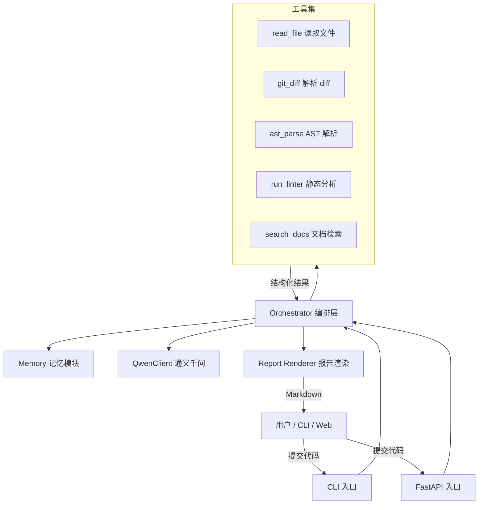
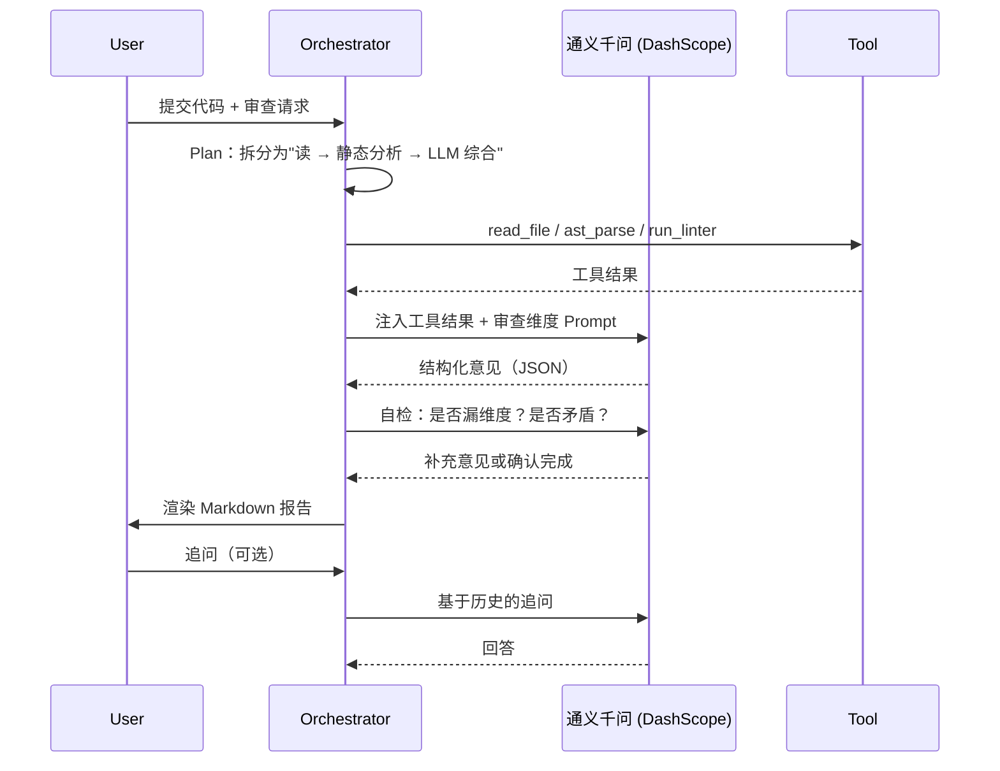

# 代码审查 Agent（Code Review Agent）

> 课程：软件工程与项目实践 · Homework 1
> 方向：代码审查 Agent
> 技术路线：Python + 通义千问（DashScope）
>
> 文档说明：本文档包含【本次作业已实现功能】和【未来规划扩展构想】；规划功能仅为设计设想，本次交付并未编码实现。
> ✅ 已实现：CLI审查、ReAct状态机主循环、read_file/ast_parse/run_linter工具、短期记忆+Token裁剪、指数退避重试、结构化报告输出、FastAPI Web界面、单元+集成测试。
> ⬜ 未实现：git_diff、search_docs、交互式追问、批量/PR‑diff审查、SQLite长期记忆、金标评测集。


## 1. 项目概述

### 1.1 背景与动机

传统 Code Review 高度消耗资深工程师时间，新人在 PR 中常常得到延迟反馈或无反馈。借助 LLM 的代码理解能力，构建一个可自动接入 PR / 文件 / 仓库的**代码审查 Agent**，可在秒级输出多维度审查意见（Bug、风格、安全、性能、可读性、设计），让 Review 从"凭经验"变成"持续在线的队友"。

本作业的目标不是做出工业级产品，而是**完整呈现一个 Agent 的设计闭环**：输入 → 推理 → 工具调用 → 输出，体现 Agent 范式与工程规范。

### 1.2 项目目标

| 目标 | 说明 |
| --- | --- |
| **G1 可用** | 给一段代码或一个 diff，能在 30 秒内输出结构化审查报告 |
| **G2 可解释** | 每条意见都能定位到文件 + 行号 + 类别 + 严重程度 |
| **G3 可扩展** | 新增审查维度 / 新工具成本低，不需改 Agent 主循环 |
| **G4 工程化** | CLI + 可选 Web 入口；支持上下文记忆与失败重试 |

### 1.3 适用范围

- **实现语言**：Python 3.11+
- **审查目标语言**：v1 仅支持 **Python 代码**（v2 预留多语言扩展）
- **首选场景**：本地单个文件审查、PR diff 审查、目录级批量审查
- **非目标**：自动修改代码（不在本期范围）、团队流程治理、与 CI 深度耦合

### 1.4 实现进度总览

主链路 **CLI → Orchestrator → ReAct 循环 → 工具调用 → 结构化 JSON → Markdown 报告** 已端到端跑通（实测输出见根目录 `report.md`）。

| 能力 |
| --- |
| CLI 单文件审查 + `--rules` / `--output` |
| 统一配置加载（`.env`） |
| Orchestrator 编排入口 `review()` |
| ReAct + 状态机主循环（8 态、8 轮上限） |
| 短期记忆（文件 hash / 结论 / 最近 5 条工具调用） |
| Token 预算控制（tiktoken + FIFO 裁剪） |
| 工具：`read_file` / `ast_parse` / `run_linter(ruff)` |
| 工具：`git_diff` / `search_docs` |
| LLM 适配（chat / chat_json / chat_stream） |
| Prompt 模板（System + 任务，Jinja2） |
| Few-shot 示例 |
| Markdown 报告 + 终端 ANSI 染色 |
| 失败重试（指数退避，最多 3 次） |
| 交互式追问 / 批量审查 / Diff 审查 |
| FastAPI Web 界面 |
| 长期记忆（SQLite 历史对比） |
| 单元测试（18 例：工具 / 记忆 / 渲染 / JSON 清洗） |
| 集成测试（5 例：状态机 / 循环上限 / 重试链路） |
| 金标测试 |


## 2. 功能需求

### 2.1 核心功能（MUST）

1. **文件 / Diff 输入**：接受单文件路径、`git diff`、PR URL。
2. **多维度审查**：至少覆盖 Bug 风险、风格与规范、安全、性能、可读性五个维度。
3. **结构化输出**：Markdown 报告，包含定位、严重程度（Blocker / Major / Minor / Info）、示例修复。
4. **工具调用**：内置至少 3 类工具——文件读取、静态分析、AST 解析。
5. **交互式追问**：用户可对单条意见追问"为什么 / 怎么改"。

### 2.2 增强功能（SHOULD）

6. **上下文记忆**：同一会话内记住已读文件、已下结论。
7. **自定义规则**：通过 YAML 配置启用 / 禁用审查维度。
8. **批量审查**：对整个目录生成汇总报告。
9. **失败重试**：LLM 调用 / 工具调用失败时自动退避重试。

### 2.3 扩展功能（COULD）

10. **Web 界面**：FastAPI + 简易前端，提交文件后流式输出报告。
11. **规则插件**：加载 `ruff` / `pylint` 等外部规则结果作为补充。
12. **历史对比**：对同一文件多次审查的结果做差异。


## 3. 技术选型

| 类别 | 选型 | 选择理由 |
| --- | --- | --- |
| 实现语言 | **Python 3.11+** | 与审查目标语言一致，`ast` 标准库可直接解析被审代码 |
| Agent 框架 | **不引入重型框架，`dashscope` SDK + 自写 ReAct 循环** | 作业重点是理解 Agent 本质（循环 + 工具 + 记忆），自写约 200 行主循环比套框架更能体现架构能力；也满足"LLM 原生 API"这条推荐实现路径 |
| LLM | **通义千问 Qwen（阿里云百炼/DashScope）** | 国内直连稳定、免费额度充足、支持 Function Calling 与 JSON Mode |
| LLM SDK | **`dashscope`（官方 SDK）为主** | 一套 SDK 覆盖调用/工具/流式；如需切换 GPT/Claude，只需替换 `llm/qwen_client.py` 一个文件 |
| 默认模型 | **`qwen-plus`**（日常）· `qwen-max`（金标评测对比） | plus 兼顾速度与质量；max 用于验证"更强模型是否提升召回" |
| 代码解析 | **Python 内置 `ast` 模块**（`ast.walk` + `NodeVisitor`） | 零第三方依赖、行号信息完整；多语言留待 v2 换 `tree-sitter` |
| 静态分析 | **`ruff`**（快、规则全）/ `pylint`（深度检查） | 与 LLM 结果交叉验证，提供"硬证据"；v1 不引入 eslint |
| Token 计数 | **`tiktoken`**（`cl100k_base` 编码） | 上下文裁剪时精确估算 token 用量（`memory.py` 已使用；已声明于 `pyproject.toml` 依赖，`pip install -e .` 一次装齐） |
| Prompt 模板 | **Jinja2**（`.j2` 模板文件） | 模板与代码分离，便于独立调优（`llm/prompt_loader.py`） |
| Web（可选） | **FastAPI + 原生 HTML** | 同为 Python 技术栈，零额外语言成本 |
| 包管理 | **`uv`**（备选 `poetry`） | 锁版本、安装快，作业易于复现 |

> **API 关键信息**（实现 `QwenClient` 时依据）：
> - 控制台：https://bailian.console.aliyun.com/ ，API Key 以 `sk-` 开头
> - Function Calling：`Generation.call(..., tools=[...], result_format="message")`，模型返回 `tool_calls` 后由本地执行、结果以 `role="tool"` 回传
> - JSON Mode：`response_format={"type": "json_object"}`（qwen-plus / qwen-max 支持）
> - 流式输出：`stream=True` + `IncrementalOutput`，用于 Web 界面逐字渲染


## 4. 系统架构

### 4.1 整体架构图



### 4.2 分层说明

| 层 | 职责 | 关键文件 |
| --- | --- | --- |
| **接入层** | CLI / HTTP 入口，校验输入 | `src/cra/cli/main.py` |
| **编排层** | Agent 主循环、子任务调度、上下文组装 | `agent/orchestrator.py`、`agent/react_loop.py` |
| **记忆层** | 会话级 Short-term Memory + 工具结果缓存 | `agent/memory.py` |
| **工具层** | 各类原子能力，可被 Agent 调用 | `tools/read_file.py`、`tools/ast_parse.py`、`tools/run_linter.py`；`git_diff` / `search_docs`（ |
| **LLM 适配层** | 封装通义千问（DashScope）调用、JSON 解析、Function Calling、Prompt 模板 | `llm/qwen_client.py`、`llm/prompt_loader.py`、`llm/prompts/*.j2` |
| **输出层** | 报告模板、严重程度染色、Markdown 渲染 | `report/renderer.py` |
| **配置** | `.env` 统一加载 | `src/cra/config.py` |


## 5. Agent 核心设计

### 5.1 Agent 主循环（ReAct + Plan-and-Execute 混合）



### 5.2 状态机

```
IDLE → COLLECTING_INPUT → PLANNING
     → TOOL_EXECUTE ⇄ TOOL_OBSERVE
     → LLM_REASON ⇄ LLM_REFLECT
     → RENDERING_REPORT → IDLE
     ↘ ERROR → RETRY (最多 3 次) → IDLE
```

> **当前实现**（`react_loop.py` 中的 `AgentState` 枚举）：8 个状态全部落地；`TOOL_OBSERVE` / `LLM_REFLECT` 合并进 `LLM_REASON` 统一处理。实际转移为：
> `IDLE → COLLECTING_INPUT → PLANNING → TOOL_EXECUTE → LLM_REASON ⇄ TOOL_EXECUTE → RENDERING_REPORT`（结束）；LLM 异常走 `ERROR → RETRY`（`sleep(2^retry_count)` 指数退避）→ `PLANNING`，最多 3 次；主循环硬上限 8 轮。

### 5.3 记忆机制

- **Short-term（会话内）**：保存已读文件 hash、已得出的结论、最近 5 条工具调用。
- **Long-term（可选）**：用 SQLite 存历史审查结果，供"历史对比"使用。（⬜ 未实现）
- **Token 预算控制**：当上下文超阈值时，按"近因 + 高严重度"裁剪。


## 6. 工具设计

每个工具遵循统一接口：

```python
class Tool(Protocol):
    name: str
    description: str        # 用于注入到 LLM 工具描述
    args_schema: type[BaseModel]

    def run(self, **kwargs) -> ToolResult: ...
```

| 工具 | 输入 | 输出 | 用途 |
| --- | --- | --- | --- |
| `read_file` | path | 文件全文（UTF-8） | 让 Agent 看清代码 |
| `git_diff` | repo_path, base_ref | 增删改 hunks | 聚焦变更而非全量 |
| `ast_parse` | path | AST 摘要（类/函数/调用关系 + 行号 + 参数） | 用 Python 内置 `ast`（`NodeVisitor`）抽取结构信息 |
| `run_linter` | path, ruleset | ruff 警告列表（JSON，30s 超时） | 给出"硬证据" |
| `search_docs` | query | Python 官方文档片段 | 解释标准库 API 用法 |

> 工具的 `description` 是 LLM 决定何时调用的关键字段，必须写得**清晰、含触发条件**（见 7.3 节）。


## 7. Prompt 设计

> 模板落地为 Jinja2 文件，由 `llm/prompt_loader.py` 的 `render_prompt()` 渲染：
> - `llm/prompts/system.j2` —— 对应 §7.1 的 System Prompt（schema 与下方设计一致，severity 为 Blocker/Major/Minor/Info，含 title/evidence/confidence 字段）；
> - `llm/prompts/task_review.j2` —— 对应 §7.2 的任务模板，注入 `file_path / enabled_categories / ast_result / lint_result`，并附 6 条硬性约束（禁止 markdown 包裹、路径用正斜杠、禁止 `\'` 转义等，用于对抗 JSON 解析失败）。
>
> 

### 7.1 System Prompt

```
你是一名资深代码审查工程师，习惯用"事实 + 依据 + 建议"三段式表达。
你的输出必须是 JSON 数组，元素结构为：
{
  "file": "相对路径",
  "line_start": int, "line_end": int,
  "category": "bug|style|security|perf|readability|design",
  "severity": "blocker|major|minor|info",
  "title": "一句话结论",
  "evidence": "代码片段或符号",
  "suggestion": "修改建议",
  "confidence": 0.0~1.0
}
绝不输出 JSON 之外的文字。
```

> **针对通义千问的小技巧**：
> - JSON Mode (`response_format={"type":"json_object"}`) 仅 `qwen-plus` / `qwen-max` 支持；`qwen-turbo` 用正则兜底。
> - System prompt 中显式写"以 JSON 输出"能显著降低 Markdown 包裹概率。
> - Function Calling 工具描述用**祈使句**更稳；schema 字段命名与 JSON Schema 严格一致。

### 7.2 任务 Prompt 模板

```
[代码上下文]
{{ language }} · 文件 {{ path }} · 行 {{ start }}-{{ end }}
{{ code_block }}

[工具反馈]
- ast 摘要：{{ ast_summary }}
- lint 警告：{{ lint_warnings }}

[任务]
按 system 约束输出 JSON；若信息不足，可调用 read_file / ast_parse 工具。
```

### 7.3 工具描述示例（决定 Agent 是否正确调用）

```yaml
- name: ast_parse
  description: |
    解析 Python 源代码的抽象语法树，返回顶层定义、函数签名、调用关系及行号。
    当需要理解"这段代码的函数之间怎么调用"或"找函数定义位置"时使用。
    输入文件路径即可，无需整段代码。
  args: { path: string }
```

> 工具 schema 需转换为 DashScope Function Calling 格式：

```json
{
  "type": "function",
  "function": {
    "name": "ast_parse",
    "description": "解析 Python 源代码的抽象语法树，返回顶层定义、函数签名、调用关系及行号。",
    "parameters": {
      "type": "object",
      "properties": { "path": { "type": "string", "description": "要解析的 .py 文件路径" } },
      "required": ["path"]
    }
  }
}
```

### 7.4 Few-shot 示例

在 system 中预置 1~2 个高质量样例，覆盖"真 Bug + 假阳性排查"，显著降低幻觉率。


## 8. 数据流示例

**场景**：用户 `python -m cra.cli.main review src/payment.py --rules security,bug`（当前实际 CLI 入口；`python -m cra review ...` 需待补 `__main__.py`）

1. CLI 解析（Click：`file_path` 位置参数 + `--rules` / `--output` 选项，`exists=True` 预校验）→ 调用 `Orchestrator.review(file="src/payment.py", rules=["security","bug"])`。
2. Orchestrator 注入初始 system/user 消息（告知 Agent 任务目标：读文件 → AST → linter → 输出结论）→ 进入 `run_react_loop`。（注：当前工具为顺序执行，由模型 Function Calling 决策驱动，未做并发调度）
3. 主循环调用通义千问 `qwen-plus`（temperature=0.2）；若模型返回 `tool_calls` → 本地执行对应工具，结果以 `role="tool"` 回传，进入下一轮循环（每轮末尾 `truncate_messages` 裁剪上下文）。
4. 模型停止调用工具 → 进入 `RENDERING_REPORT`：渲染 `system.j2` + `task_review.j2`（注入工具历史）→ `chat_json` 获取结构化意见（JSON）→ `ReviewFinding`（Pydantic）校验。
5. 校验失败 / LLM 异常 → 进入 `ERROR` → `RETRY`（指数退避，最多 3 次）；最终失败由 CLI 捕获并打印"审查失败"。
6. 通过校验 → `MarkdownReportRenderer` 输出 Markdown（`-o` 写文件）或终端 ANSI 染色报告。


## 9. 错误处理与重试

| 失败类型 | 处理策略 |
| --- | --- |
| LLM 超时 / 5xx | 指数退避重试 3 次；最终失败给用户明确错误 |
| LLM 输出非 JSON | 清洗后重试 |
| 工具执行异常 | 标记工具结果为 error，继续流程并降级输出 |
| 文件不存在 / 编码错误 | CLI 阶段直接报错，避免进入 Agent |
| Token 超限 | 触发记忆裁剪，重发请求 |


## 10. 部署与运行

```bash
# 安装（依赖已完整声明于 pyproject.toml，含 tiktoken / pytest 可选依赖）
pip install -e .          # 基础安装
pip install -e ".[test]"  # 含测试依赖（pytest）

# 配置 LLM Key（通义千问 DashScope）
cp .env.example .env
# 编辑 .env，填入：
#   DASHSCOPE_API_KEY=sk-xxxxxxxxxxxxxxxx
#   CRA_LLM_MODEL=qwen-plus        # 可选：qwen-turbo / qwen-plus / qwen-max

# 单文件审查（当前实际入口）
python -m cra.cli.main review path/to/file.py
python -m cra.cli.main review path/to/file.py --rules bug,security
python -m cra.cli.main review path/to/file.py -o report.md

# 原型 / 调试脚本
python debug_llm.py              # API 连通性测试
python code_review_agent.py      # 早期独立原型（qwen-turbo，自然语言输出）
```

**规划中命令**（尚未实现，需补 `cra/__main__.py` 与 `review-pr` 子命令）：

```bash
# 短入口（待实现：python -m cra review ...）
python -m cra review path/to/file.py

# PR Diff 审查（待实现）
python -m cra review-pr ./repo --base main

# 启动 Web（待实现）
uvicorn web.app:app --reload
```

**`llm/qwen_client.py` 当前实现要点**（基于 `dashscope` 官方 SDK）：

```python
class QwenClient:
    def __init__(self, cfg: QwenClientConfig):
        # 模型白名单校验：qwen-turbo / qwen-plus / qwen-max
        # 设置 dashscope.api_key

    def chat(self, messages, tools=None) -> dict:
        """Agent 主循环用：返回原始 message（含 content 或 tool_calls）
        任何异常统一封装为 LLMRequestError"""

    def chat_json(self, system: str, user: str):
        """意见生成用：system/user 组装为 messages 后复用 chat()，
        再对返回文本做三步清洗后 json.loads：
        1) 剥离 ```json ... ``` markdown 围栏；
        2) 截取第一个 [ 到最后一个 ] 的 JSON 数组；
        3) 去除 \' 反斜杠转义。
        解析失败打印原始内容并抛 LLMRequestError"""

    def chat_stream(self, messages):
        """流式输出（stream=True），生成器逐 chunk yield，预留 Web SSE 使用"""
```

> **实现要点（v0.3 更新）**：实测中模型对原生 JSON Mode（`response_format={"type":"json_object"}`）的返回仍不稳定（偶发 markdown 围栏 / 转义错误），因此 `chat_json` 已改为**复用 `chat()` + 正则清洗提取**的方案，对三类模型行为一致。`response_format`（JSON Mode）与 `tools`（Function Calling）**不要在同一次调用中同时使用**的设计约束仍然有效——工具决策阶段用 `chat(tools=...)`，意见生成阶段用 `chat_json(...)`。

**`.env.example`**：

```ini
# 通义千问 DashScope（https://bailian.console.aliyun.com/）
DASHSCOPE_API_KEY=sk-xxxxxxxxxxxxxxxxxxxxxxxx

# 模型选择：qwen-turbo（便宜） / qwen-plus（默认，推荐） / qwen-max（强推理）
CRA_LLM_MODEL=qwen-plus

# Agent 行为
CRA_MAX_RETRIES=3
CRA_TEMPERATURE=0.2
CRA_LOG_LEVEL=INFO
```


## 11. 测试策略

| 类型 | 工具 | 覆盖目标 |
| --- | --- | --- |
| 单元测试 | `pytest` | 各工具函数、Schema 校验、记忆裁剪、JSON 清洗 |
| 集成测试 | `pytest + FakeQwenClient mock` | Agent 完整状态机流程（无需真实 LLM 响应） |
| Prompt 评估 | 自建 10 条金标样例 | 维度召回率、严重程度一致性 |
| 端到端 | shell 脚本 | CLI 命令、错误路径 |

> **金标样例**是关键评测集：手工编写 10 段带"已知 bug + 已知无问题"的代码，用于评估 Agent 召回率与误报率。
> 目前已有一组人工验证样例：以 `1.2.py`（学生字典操作脚本，含结构不一致、`len(s)-1` 计数等已知问题）为输入，Agent 输出 `report.md`（5 条意见：1 Blocker / 2 Major / 2 Minor，类别覆盖 bug / security / readability / style），可作为后续金标评测的起点。


## 12. 项目结构

```
CodeReview_Agent/
├── Design.md                      # 设计文档（架构设计、实现进度矩阵、已知问题）
├── README.md                      # 项目说明与使用方法（本文件）
├── pyproject.toml                 # 包与依赖声明（含 web / test 可选依赖）
├── examples/                      # 审查样例
│   ├── test_case.py               # 正常可运行样例（含命名 / 类型使用等问题）
│   ├── bad_case.py                # 语法错误样例（验证边界情况处理）
│   └── empty.py                   # 空文件样例（验证边界情况处理）
├── src/cra/
│   ├── config.py                  # AppConfig + load_config()：.env 统一加载
│   ├── __main__.py                # 短入口：python -m cra review ...
│   ├── cli/main.py                # CLI 入口（review 子命令：--rules / -o）
│   ├── agent/
│   │   ├── orchestrator.py        # 编排入口：review(file_path, rules)
│   │   ├── react_loop.py          # ReAct 主循环 + AgentState 状态机
│   │   └── memory.py              # SessionMemory + Token 裁剪
│   ├── llm/
│   │   ├── qwen_client.py         # QwenClient：chat / chat_json / chat_stream
│   │   ├── prompt_loader.py       # Jinja2 模板渲染
│   │   └── prompts/               # system.j2 / task_review.j2（Prompt 模板）
│   ├── tools/
│   │   ├── read_file.py           # Tool 协议 + ToolResult + ReadFileTool
│   │   ├── ast_parse.py           # AstParseTool
│   │   └── run_linter.py          # RunLinterTool（ruff）
│   ├── report/renderer.py         # ReviewFinding + Markdown / 终端渲染
│   └── web/                       # FastAPI Web 界面（python -m cra.web）
│       ├── app.py                 # 路由：首页 / 提交审查 / 轮询任务 / 报告下载 / 样例
│       ├── tasks.py               # 后台线程执行审查 + 事件存储（文件名校验防路径穿越）
│       ├── instrument.py          # 探针：包装 QwenClient 与工具，上报事件（不侵入核心）
│       ├── __main__.py            # uvicorn 启动入口
│       └── static/index.html      # 单页前端（无外部 CDN 依赖）
└── tests/                         # 测试目录（单元 + 集成 = 23 例，pytest 运行）
    ├── unit/                      # 工具 / 记忆 / 渲染 / JSON 清洗
    └── integration/               # ReAct 状态机（FakeQwenClient mock）
```


## 13. 已实现 / 规划中

| 能力                                                         | 状态     |
| ------------------------------------------------------------ | -------- |
| CLI 单文件审查 + 维度过滤 + Markdown 输出（`python -m cra review` / `python -m cra.cli.main review`） | ✅        |
| ReAct Agent 主循环 + 状态机 + 失败重试（含报告阶段重试）     | ✅        |
| 工具：read_file / ast_parse / run_linter                     | ✅        |
| 结构化 JSON 意见 + Markdown / 终端渲染（Pydantic 枚举强校验） | ✅        |
| 短期记忆 + Token 预算裁剪                                    | ✅        |
| 边界情况样例（语法错误 / 空文件，见 `examples/`）            | ✅        |
| 单元 / 集成测试（23 个用例，`pytest` 一键运行，无需 API Key） | ✅        |
| `git_diff` / `search_docs` 工具                              | ⬜ 规划中 |
| 交互式追问（为什么 / 怎么改）                                | ⬜ 规划中 |
| 批量目录审查 / PR Diff 审查                                  | ⬜ 规划中 |
| FastAPI Web 界面（`chat_stream` 接口已就绪）                 | ✅        |
| SQLite 长期记忆 / 历史对比                                   | ⬜ 规划中 |
| 金标评测集（量化召回 / 误报率）                              | ⬜ 规划中 |


## 14. 风险与权衡

| 风险 | 应对 |
| --- | --- |
| LLM 幻觉 → 编造行号 | 用 Pydantic 强制 schema + 与 ruff/pylint 结果交叉验证 |
| Token 成本失控 | 默认只传 diff + AST 摘要；按需 read_file；默认 `qwen-plus` 平衡成本 |
| DashScope 速率限制（QPM/RPM） | 实现令牌桶 + 指数退避；批量审查时串行化 |
| JSON Mode 与 Function Calling 不能同时开启 | `QwenClient` 内拆分为 `chat(tools=...)` 与 `chat_json(...)` 两个入口，主循环分阶段调用 |
| 模型输出不稳定（markdown 围栏 / `\'` 转义 / 路径反斜杠） | `chat_json` 内置三步正则清洗 + `task_review.j2` 硬性约束（禁 markdown、路径用 `/`、禁 `\'`） |
| `qwen-turbo` 不支持 JSON Mode | 配置校验：选 turbo 时自动降级为"正则提取 JSON + 重试" |
| 自写循环可能遗漏边界（如工具无限循环） | 状态机限制最大轮次（默认 8 轮）+ 每轮记录工具调用日志 |
| 评审标准"功能完整性"难量化 | 用金标样例量化召回/误报，作为客观证据 |


## 15. 常见问题

- **`审查失败：...`**：确认 `.env` 位于运行目录且 `DASHSCOPE_API_KEY` 正确；检查网络能否访问 DashScope。
- **`ModuleNotFoundError: cra`**：先执行 `pip install -e .` 安装项目；或设置 `PYTHONPATH=src` 后运行。
- **工具调用报错**：确认 `ruff` 已安装且可执行（`pip install -e .` 已包含）；被审文件使用 UTF-8 编码。
- **JSON 解析失败**：`chat_json` 内置正则清洗已处理常见的 markdown 围栏 / `\'` 转义问题；若仍失败，会打印原始输出便于排查。
- **Web 页面弹出 `Failed to fetch`**：说明是直接双击打开了 `index.html` 文件（`file://` 协议），前端无法连接后端。请通过服务地址访问：先 `python -m cra.web`，再浏览器打开 `http://127.0.0.1:8000`。
- **Web 顶部红点提示"未配置 DASHSCOPE_API_KEY"**：在项目根目录创建 `.env` 写入 Key 后，重启服务（`Ctrl+C` 后重新 `python -m cra.web`）——配置仅在启动时加载一次。
- **端口被占用**：`python -m cra.web --port 8001` 换端口启动，或结束占用 8000 端口的进程。


## 16. 后续可拓展方向

- 接入 GitHub/GitLab API 实现"PR 评论机器人"
- RAG：索引项目内文档与历史 PR，提升上下文感
- 微调小模型做"分类头"加速维度判断
- 多 Agent：审查 Agent + 验证 Agent + 修复 Agent 协同

